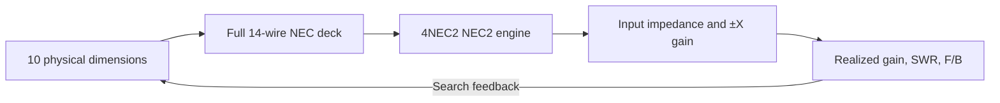

# ⚡ 14-Wire Yagi–Corner Antenna Optimization

> A reproducible 300 MHz antenna search using Python and the NEC2 engine bundled with [4NEC2](https://www.qsl.net/4nec2/).

One driven dipole, nine rods in a 120° corner reflector, and four independently sized and spaced directors form the **complete 14-wire model**. Every search candidate is evaluated by NEC2 with all 14 wires and 31 segments per wire. The optimization uses no reduced electromagnetic or parameter model.

## 🏆 Key result

| Metric | Initial four-director design | Optimized design |
|:--|--:|--:|
| Realized forward gain at 300 MHz | 12.5331 dBi | **13.0500 dBi** |
| SWR at 300 MHz, 50 Ω | 1.1706 | **1.000013** |
| Forward-to-back ratio at 300 MHz | 8.31 dB | **10.22 dB** |
| 2:1 SWR bandwidth containing 300 MHz | 5.5873 MHz | **4.5298 MHz** |

The realized-gain improvement is **0.5169 dB**. The higher-gain design has a narrower 2:1 SWR band: **297.1535–301.6833 MHz**. These are free-space NEC2 simulation results, not measurements. The final deck is [`models/E3.nec`](models/E3.nec), and the independently checked numbers are in [`results/Experiment3/results.json`](results/Experiment3/results.json).

## 🧬 Model and solver flow



| Geometry | Fixed or optimized setting |
|:--|:--|
| Driven dipole | 0.4626 m length, centre-fed at the origin |
| Corner reflector | Nine 8 mm diameter rods, 0.15 m spacing along each wing, 120° included angle |
| Directors | Four 8 mm diameter rods in front of the driven dipole |
| Discretization | 31 NEC segments per rod; free space |
| Design point | 300 MHz; forward +X, backward −X; 50 Ω reference |

The search varies the corner apex distance, common reflector length, four director lengths, and four consecutive director gaps. It keeps the driven length, wire diameter, reflector spacing, and corner angle fixed. The final apex distance is **0.1028049 m**, and reflector length is **0.5103174 m**.

| Director | Length (m) | Gap from previous element (m) | X position (m) |
|--:|--:|--:|--:|
| 1 | 0.4379216 | 0.1826665 | 0.1826665 |
| 2 | 0.4255981 | 0.2798626 | 0.4625291 |
| 3 | 0.4206466 | 0.3537916 | 0.8163207 |
| 4 | 0.4263909 | 0.3556554 | 1.1719761 |

The optimization maximizes realized gain at 300 MHz while requiring **SWR ≤ 2** and **F/B ≥ 8 dB**. Those two limits are search quality gates. They are not numerical limits specified in the assignment brief. Realized gain includes mismatch loss:

```text
Gamma = (Zin - 50) / (Zin + 50)
G_realized [dBi] = G_NEC [dBi] + 10 log10(1 - |Gamma|^2)
```

## 📂 Repository layout

```text
.
├── README.md                 Project overview and reproduction steps
├── LICENSE                   MIT License
├── requirements.txt          Python dependencies
├── .gitignore
├── optimize_full.py          Initial differential-evolution search
├── refine_full.py            Bounded restart and local refinement
├── advanced_full.py          Sobol/archive-seeded expanded search
├── publish_full.py           Independent deck audit and result export
├── advanced_result.json      Best search parameters and 300 MHz result
├── models/
│   ├── E1.nec
│   ├── E2.nec
│   └── E3.nec                Final 14-wire antenna
└── results/Experiment3/
    └── results.json          Delivered result summary
```

Intermediate traces, candidate decks, and detailed sweep CSV files are generated locally by the scripts and are not required in the public repository.

## ⚙️ Quick start

**Requirements:** Windows, Python 3.12+, and 4NEC2. The verified setup used Python 3.12.5, NumPy 2.1.2, SciPy 1.17.0, and `C:\4nec2\exe\nec2dxs1K5.exe`. If your 4NEC2 engine is installed elsewhere, change `ENGINE` in `optimize_full.py`.

From the repository root in PowerShell, install dependencies and regenerate the delivered model from the committed parameters:

```powershell
python -m pip install -r requirements.txt
python publish_full.py --source advanced_result.json --output-root .\output
```

The command checks the delivered deck with a separate NEC2 run using 361-point elevation and azimuth patterns. It writes `output/E3.nec`, `output/Experiment3/results.json`, a frequency sweep, director table, and two 41-point director sweeps. Each sweep point uses the complete 14-wire model. `output/` is ignored by Git.

To repeat the full search from the initial design:

```powershell
python optimize_full.py
python refine_full.py
python advanced_full.py
python publish_full.py --source advanced_result.json --output-root .\output
```

The stages use fixed random seeds. Their generated traces feed the next stage; a clean checkout contains everything needed to start. Parallel scheduling and NEC2 or library versions can change small numerical details. The search reports its best evaluated candidate and does not establish a global optimum.

## 🔬 Numerical sensitivity

At exactly 300 MHz the optimized ideal model has `Zin ≈ 49.9994 + j0.00021 Ω`, giving **S11 ≈ −104 dB** in the NEC2 output. This unusually deep point is sensitive to dimension rounding and small changes in frequency, fabrication, conductors, and the surrounding environment. The finite **4.5298 MHz** 2:1 SWR bandwidth is a more useful matching summary. The simulation omits a real feed, supports, material losses, and nearby objects. F/B compares the exact +X and −X directions.

## 📄 License

MIT License © 2026 Haoran Feng. See [LICENSE](LICENSE).
